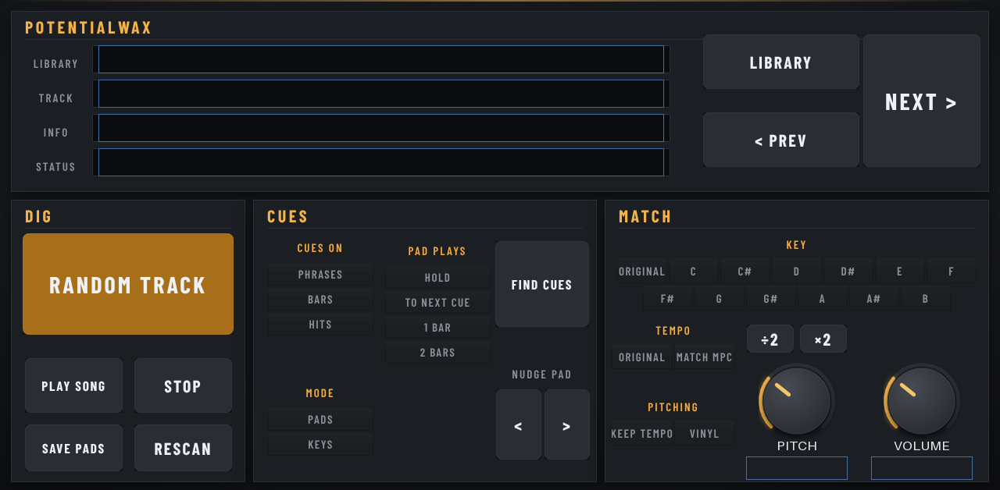
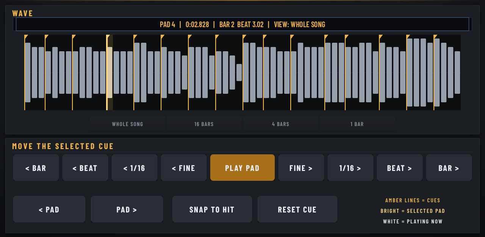

# PotentialWax

**Dig, flip, play.** A melodic sampler in the spirit of Serato Sample: pick a song from your own library (or let it dig one out), and it finds 16 cue points, works out the tempo and key, and matches them to your project.

*Instrument plugin · MPC OS 3.x · Gen1 and Gen2 · v1.3.2*

Inspired by the way Serato Sample works on computers. Not affiliated with Serato.

Free and open source (MIT), made by **PotentialBreaks**. It runs inside the MPC like its own instruments, with its own touchscreen page, Q-Link control and project recall, and no computer needed while you play.

**[Download the latest release](../../releases/latest)** · [Install guide](INSTALL-GUIDE.md) · [FAQ](FAQ.md) · [Ideas and bugs](../../issues/new/choose)

## What it does

- **RANDOM TRACK** digs out a song from your library. **PREV** and **NEXT** step through them, **LIBRARY** switches folders, and the **BROWSE** page lists 10 songs at a time so you can tap the one you want.
- **Analysis:** tempo (75–150 BPM, or the "92bpm" in the file name), the downbeat and the key are worked out when a song loads.
- **16 cues, found for you.** **CUES ON** chooses where they go: **Phrases** (4-bar phrase starts), **Bars**, or **Hits**. **FIND CUES** rolls a new set, and **NUDGE < >** moves the last pad's cue.
- **MODE:**
  - **Pads:** each pad plays from its cue. **PAD PLAYS** sets how long: Hold, To Next Cue, 1 Bar or 2 Bars.
  - **Keys:** the last pad you played, spread chromatically over the keyboard from the ROOT note.
- **MATCH:**
  - **TEMPO:** Original, or Match MPC.
  - **KEY:** Original, or any key from C to B (moves the shortest way, −6 to +5 semitones). **PITCH** adds ±12 on top.
  - **PITCHING:** **Keep Tempo** (time-stretch, so the speed stays put) or **Vinyl** (speed and pitch move together, like a turntable).
- **Cut loops are recognised.** A file that's a whole number of bars (1, 2, 4, 8, 16 or 32) gets its exact tempo from its length, starts its bar 1 at the start of the file, and its cues go on its beat grid (INFO shows "LOOP 4 BARS"). Cues are nudged onto the actual hit.
- **÷2 / ×2** halve or double the tempo it found, for half-time and double-time samples. Matching, pad lengths and NUDGE follow it, and your project remembers it.
- **SAVE PADS** writes the 16 chops as you hear them to WAV files, ready to load into a drum program.
- **PLAY SONG** / **STOP** play the whole song. **CHOKE**, **RELEASE** and **LEARN** are on the SETUP page.
- Your project remembers the song, the cues and every setting.

## The WAVE page

- **See every cue:** the song's waveform with all 16 cue points as amber lines. The selected pad's cue glows brighter, and a white line follows playback.
- **Playing a pad selects it**, so you see straight away where it starts. **< PAD / PAD >** pick one without playing.
- **VIEW:** the whole song, or zoom in to 16, 4 or 1 bar around the selected cue.
- **Move the selected cue** by a bar, a beat, a 1/16 note or a tiny step (5 ms), backwards or forwards. **PLAY PAD** to hear it.
- **SNAP TO HIT** moves the cue onto the nearest real hit; **RESET CUE** puts it back where it was found.
- The info line shows the pad, its exact time and its bar and beat. Your project remembers the cues.

## Where it finds your songs

You don't have to type any paths. It looks in three places:

1. **A folder called `MELODIC LIBRARY`** at the top of any drive (SD card, USB drive or SSD).
2. **Any folder at the top of a drive with "melodic", "wax", "flip" or "songs" in its name.**
3. **Folders you list yourself** in `PotentialWax/folders.txt` on that drive (one folder per line, a full path or a folder on that drive).

Every sub-folder becomes a **library**. After adding songs, tap **RESCAN**. **MP3, WAV and FLAC** files are supported.

## Three looks

PotentialWax comes in three looks: **Print Plate** (the default), **Night Rack** and **Colour Block**. Open the **SETUP** page and tap one of the big LOOK keys. The new look shows the next time the plugin loads: take it off the track and add it again, or load your project again. Your choice is kept on your MPC for every project. The sound and the controls are the same in all three.

## Limitations

- **Only the first 6 minutes of a song are used**, and files shorter than about 2 seconds are skipped.
- **Tempo, key and cues are a best guess.** Songs with tempo changes, rubato or unusual keys can fool it. Putting the BPM in the file name fixes the tempo.
- **Keep Tempo stretching is clean but not studio-grade.** Big tempo or key changes sound more "stretched". Vinyl mode has no stretch artefacts at all.
- **8 voices**, and only 44.1 kHz playback.
- **The pads map like a keyboard.** LEARN sets which note is pad 1.
- **SAVE PADS** writes to a `PotentialWax` folder on the song's drive.
- **Tested on an MPC One only** (Gen1). The 64-bit build for Gen2 MPCs passes Akai's own checks but hasn't been tried on a Gen2 MPC yet.

## Will it work on my MPC?

| | |
|---|---|
| **Tested on** | MPC One (Gen1): with Akai's plugin folder on **MPC OS 3.10.1**, and with the community set-up on HAKAI 3.10 |
| **Should work on** | Any standalone MPC on **MPC OS 3.10.1 or later**: 32-bit (One, One+, Live, Live II, X, Key 61, Key 37) and 64-bit (Live III, XL, One Gen 2, Key 37 Gen 2). Also Gen1 MPCs on older MPC OS 3.x with the community set-up |
| **Not supported** | **MPC OS 2.x** |

The **Should work on** row is untested so far. If you try it on another model, please [tell me how it went](../../issues/new/choose).

## Install

**👉 [Step-by-step install guide](INSTALL-GUIDE.md)**

**On MPC OS 3.10.1 or later** (any standalone MPC, no hacking):
1. Download `PotentialWax-<version>-akai-vst2.zip` from [**Releases**](../../releases) and unzip it on your computer.
2. On the MPC, turn on **Preferences → Enhancements (Beta) → Enable Enhancements** and **External Plugin Support**.
3. Copy the folder **PotentialBreaks - VST - PotentialWax** into a folder called **VST2 Plugins** at the top of a USB stick, SD card or the internal drive, and restart.
4. It's in **External Plugins**, as an instrument.

**On older MPC OS 3.x (Gen1, community set-up):** download `PotentialWax-<version>-mpc-armv7.zip` instead and install it with the free **MPC Plugin Installer** from [Open MPC](https://open-mpc.github.io/), or over SSH (see the guide). Save your project first, because installing restarts the MPC app.

Install it one way only, or it shows up twice. Stuck? The [**FAQ**](FAQ.md) covers the common problems.

## Also good to know

- **Made by one person, tested on one MPC.** It works well for me, but you may hit something I haven't. Please tell me if you do.
- **Plugins must be allowed to run on your MPC.** On MPC OS 3.10.1 or later, that's the **External Plugin Support** switch in Preferences → Enhancements (Beta). On older firmware, your MPC needs the community set-up from [Open MPC](https://open-mpc.github.io/), which you may have to redo after a firmware update.
- **No warranty.** It's free and comes as it is. Back up your projects.

## Ideas, bugs and criticism: all welcome

I make these for myself first, and I want them to be good for everyone else too, so **please tell me what you think**, including what you don't like.

- 💡 [Suggest a feature](../../issues/new?template=idea.yml)
- 🐛 [Report a bug](../../issues/new?template=bug.yml)

You don't need to be technical. Short messages are great. See [CONTRIBUTING.md](CONTRIBUTING.md) for more, including how to send code.

## More from PotentialBreaks

- **[PotentialBreaks](https://github.com/PotentialBreakfast/mpc-vst-potentialbreaks)**: Drum-break slicer: a random break from your library on 16 pads, chopped and tempo-matched.
- **[PotentialPatina](https://github.com/PotentialBreakfast/mpc-vst-potentialpatina)**: Retro-colour insert effect: vinyl and tape noise, wobble, drive, bit-crush, tone and room in one box.
- **[PotentialNoise](https://github.com/PotentialBreakfast/mpc-vst-potentialnoise)**: Calibrated pink noise reference for mixing: one-tap RMS levels, mono/stereo, full or limited range, live meter.
- **[PotentialPunch](https://github.com/PotentialBreakfast/mpc-vst-potentialpunch)**: Transient shaper: more or less punch and tail on drums and anything else, with one-tap presets.
- **[PotentialHeat](https://github.com/PotentialBreakfast/mpc-vst-potentialheat)**: Soft clipper and bus saturator: warmth, glue and loudness without clipping, with one-tap presets.
- **[PotentialWarp](https://github.com/PotentialBreakfast/mpc-vst-potentialwarp)**: Tempo-locked mangler: stutters, half speed, tape stops, spinbacks, reverses and gates in 16 one-tap patterns.
- **[MPC TOOLS](https://github.com/PotentialBreakfast/mpc-tools)**: a free second-screen app for Windows: your MPC's screen live on your PC (and in OBS), file transfer, your PC's folders on the MPC, and one-click "save the last 60 seconds".

## Build it yourself

See [BUILD.md](BUILD.md).

## Credits

- Built on **[mpc-vst-plugins](https://github.com/sd88me/mpc-vst-plugins)** by sd88me (MIT), the open kit that makes MPC plugins possible: the plugin wrapper, skin builder and installer.
- Audio file reading by **[dr_libs](https://github.com/mackron/dr_libs)** (dr_wav, dr_flac and dr_mp3) by David Reid (public domain / MIT-0).
- Fonts: **Jost**, **DM Mono**, **IBM Plex Sans Condensed**, **IBM Plex Mono**, **Bricolage Grotesque** and **Space Mono** (SIL Open Font License 1.1), in `vst/skin/looks/fonts/` with their licences.
- The dark look grew out of the theme I made for sd88me's Lucky Dip.
- Made with help from Claude (Anthropic).

Not affiliated with or endorsed by Akai Professional or inMusic. MPC is their trademark.

## Licence

[MIT](LICENSE): free to use, change and share, including in your own projects. Third-party parts keep their own licences ([THIRD_PARTY.md](THIRD_PARTY.md)).
